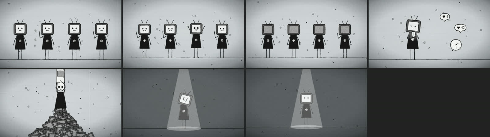
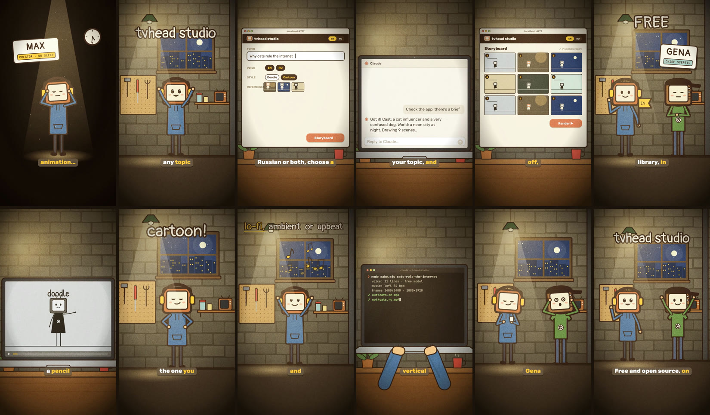
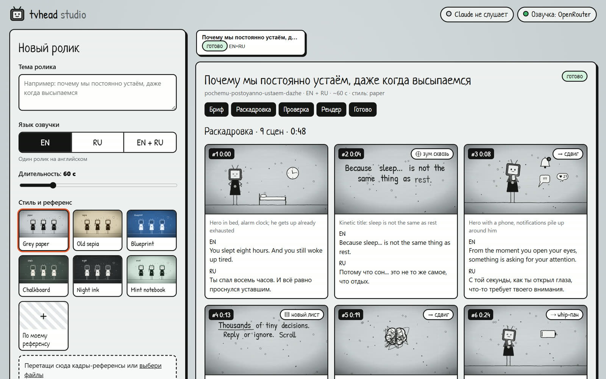
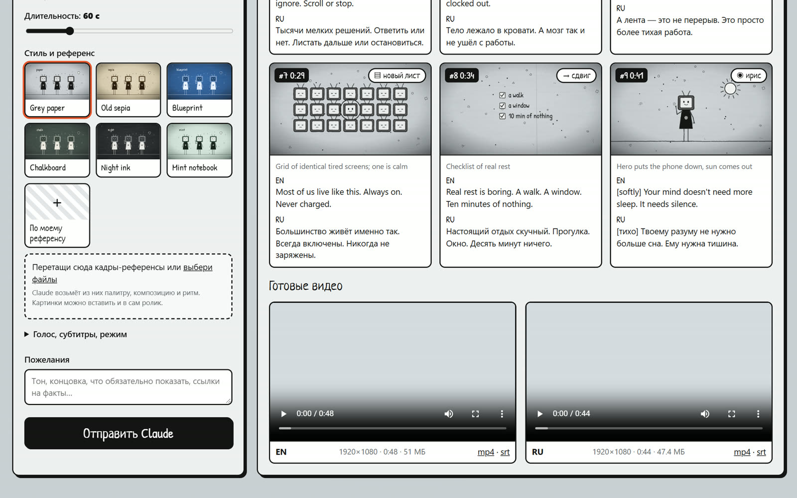

# tvhead studio: from a topic to a finished motion video

A [Claude Code](https://claude.com/claude-code) skill and a local app. Type a topic and get a **finished mp4**, horizontal **1920×1080** or vertical **1080×1920** (Shorts, Reels, TikTok), narrated in **English, Russian or both**, with free generated background music. Two looks:

- **Doodle**: hand-drawn and black-and-white. TV-headed stick figures on grey paper, floating pencil doodles, boiling lines and film grain.
- **Cartoon**: a warm night-garage cartoon. Thick outlines, colour, live laptop screens (a Claude chat, the app itself, a terminal), name badges, karaoke captions and a lo-fi beat.





The promo video above was made with the skill itself: `episodes/promo/story.json` → `node make.mjs promo`.

## Features

- **Eight looks, one story API.** Doodle, cartoon, **3D desk** (UI lying on a desk under a moving 3D camera, a clay cube mascot hopping over a post, a timeline or a beat maker), **neon noir** (painted scenes + clean infographic cards), **Dota-like** dark fantasy, **Roblox-like** brick game, **8-bit** and **comic**. Each brings its own places, characters, HUD props, caption style and music. Set `"look": "cartoon"` (or pick **Cartoon** in the app) for the warm garage cartoon. It comes with its own places (`garage`, `desk`, `blackout` with a spotlight), a `screen` prop that plays a live Claude chat, the studio app, a terminal or a doodle video, name `badge`s and outlined kinetic type.
- **Free background music.** Lo-fi, ambient, upbeat, chiptune, synthwave or epic, composed on the fly from code (no samples, no API). It follows the edit: the drums come in after the intro, drop out in dark scenes and hit on the big transitions, and the music ducks under the voice. You can also bring your own mp3.
- **Free narration.** Fish Audio S2.1 (free tier) runs through OpenRouter. Use any voice from the fish.audio library or your own clone: the id is in the link, `fish.audio/m/<id>`.
- **16:9 or 9:16.** Set `"format": "9:16"` (or flip the toggle in the app) for vertical video. Layouts, kinetic type, camera moves and captions are re-laid for the tall frame; captions stay clear of the Shorts/Reels/TikTok UI. Any story can also be rendered the other way with `--format 9:16`.
- **EN, RU or both from one story.** The pictures are shared, and each language gets its own voice and timing. You get `out/<slug>.en.mp4` and `out/<slug>.ru.mp4`, each with an `.srt`.
- **Edited like a motion designer would.**
  - Velocity-matched transitions: cut-the-curve, zoom-through and inverse zoom, plus whip pan, iris, wipe and page.
  - Kinetic type: each word lands exactly when it is spoken.
  - Doodle infographics: counter, bars, pie, progress, timeline, checklist and an odd-one-out grid.
- **Your own cast and world.** In the app's **Cast & world** tab, save cards for characters, places, styles and ideas, with reference images. Tick them in a brief, or just describe who and where in two text fields. Claude turns them into characters built from about 70 parts (11 heads, 9 bodies, 14 hats, glasses, ties, backpacks, capes, held items) and 16 environments (office, city at night, subway, forest, sea, space, stage…) with rain, snow, leaves or wind. Anything missing, Claude invents from the topic's meaning or draws as new parts in code. The storyboard opens with a cast sheet you can approve or correct.
- **A living rig.** About 20 poses and 17 faces. The figures anticipate moves, their antennas swing after a move, and they squash on landing. There are about 50 props.
- **Themes and references.** Six palettes: grey paper, sepia, blueprint, chalkboard, night and mint. You can also upload your own frames, and Claude takes the palette and pacing from them. User photos can appear in the video as taped polaroids.
- **Custom motion.** For one-off scenes, write GSAP timelines (seeked and deterministic) inside the episode.
- **Fast.** Rendering runs at about real time: 50 s of 1080p takes about 30 s on 16 threads.

## The app

The interface speaks **English and Russian** — switch with the RU / EN toggle in the header (it follows your browser language on first start and is independent of the narration language).



1. Double-click the **tvhead studio** shortcut on your desktop (create it once with `npm run shortcut` in the studio, or `bootstrap.sh --shortcut`). It starts the app in the background (no console window) and opens http://localhost:4777; clicking it again just reopens the page. The ⏻ button in the header stops it. (`start-app.cmd` / `./start-app.sh` / `npm run app` do the same.)
2. Pick the languages (EN / RU / EN + RU), the format (16:9 / 9:16), the look (eight to pick from) and the music, choose a palette or drop in reference images, tick cards from your Cast & world library or describe the characters and places, and type the topic.
3. Tell Claude in chat: **"check the tvhead app"**. Claude starts listening to the app (the header shows "Claude is listening"), picks up the brief, and writes the script and a storyboard with transitions.
4. Review the frames. You can edit the narration right in the cards or send feedback. Then press **Render**.
5. Watch and download the finished videos in the app.

You can also skip the chat: the "Claude Code CLI in the background" mode runs `claude -p` for you.



## Install

```
/plugin marketplace add Vladic20/tvhead-studio
/plugin install tvhead@tvhead-studio
```

You need Node ≥ 18, ffmpeg and Google Chrome. On first use the skill sets up its studio in `~/tvhead-studio`.

Put your key into `~/tvhead-studio/.env`:

```
OPENROUTER_API_KEY=sk-or-v1-...
```

Get a key at https://openrouter.ai/keys.

- The default model is free, but OpenRouter limits free models to about 20 requests per minute plus a daily cap.
- For a more "acted" delivery, set the paid model `TVHEAD_TTS_MODEL=fish-audio/drama-3` (about $2 per million characters).
- A Fish Audio key only works with paid Fish API credit. The free fish.audio plan credits don't apply to the API.
- Captions and cues use free word timing aligned on the audio's pauses. For more precise sync, set `TVHEAD_STT=on` (Whisper, about $0.0002 per minute).

## Without the app

Just ask Claude: *"Make a 60-second video about why we procrastinate, in English and Russian."*

Commands inside the studio:

```bash
node make.mjs demo --stills auto     # one frame per scene → episodes/demo/build/<lang>/sheet.png
node make.mjs demo --preview         # fast 720p draft
node make.mjs demo                   # final 1080p for every language
node make.mjs demo --format 9:16     # the same story as a vertical 1080×1920 video
node make.mjs promo                  # the cartoon-style promo (9:16, EN + RU)
node make.mjs look-dota              # 15-second test of a look (look-desk3d, look-noir, look-blocks, look-pixel, look-comic)
node voices.mjs deep calm --lang en  # search Fish voices (no key needed)
```

## What's inside

```
plugins/tvhead/skills/tvhead-video/
  SKILL.md                 the workflow Claude follows (chat requests and app jobs)
  references/              story.json API, motion rules, writing guide, reference sheet
  scripts/bootstrap.sh     sets up or refreshes the studio (~/tvhead-studio)
  template/
    make.mjs               story.json → voice → timeline → frames → mix → mp4, once per language
    app/                   local studio app: server, Claude bridge, UI
    engine/                SVG drawing: paper, doodles, rig, props, kinetic type, transitions, cartoon style + live screens
    lib/                   story → timeline, TTS and alignment, music generator, sound mix, parallel frame capture
```

## Credits

- The motion rules are distilled from open skills: [HyperFrames](https://github.com/heygen-com/hyperframes), [GSAP skills](https://github.com/greensock/gsap-skills), [Charlie's motion-graphics-skills](https://github.com/charlie947/motion-graphics-skills), [video-shotcraft](https://github.com/Vincentwei1021/video-shotcraft), [product-launch-motion](https://github.com/AbubakrChan/product-launch-motion) and [claude-motion-design](https://github.com/howseen-ai/claude-motion-design). For more, see [awesome-claude-video-skills](https://github.com/zhuyansen/awesome-claude-video-skills).
- The code-rendering approach started from [garazh-skill](https://github.com/lubluniky/garazh-skill) (MIT); the cartoon look (warm garage, outlines, badges, karaoke captions, the Claude chat on a laptop) is modelled on its cartoon reel.
- Fonts: Patrick Hand, Neucha, Pangolin, Rubik, JetBrains Mono, Inter, Bangers, Russo One, Cinzel, Cormorant SC and Press Start 2P (SIL OFL 1.1).
- "Dota-like" and "Roblox-like" looks are original drawings inspired by those games' visual language; no game assets or logos are used. GSAP is used under its standard no-charge license.
- Voices are Fish Audio voice models, used under Fish Audio's terms. Don't use voices that imitate real people without their consent.

MIT, see [LICENSE](LICENSE).
