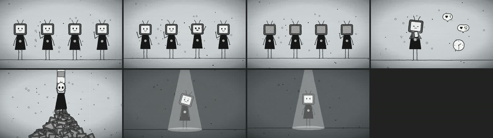
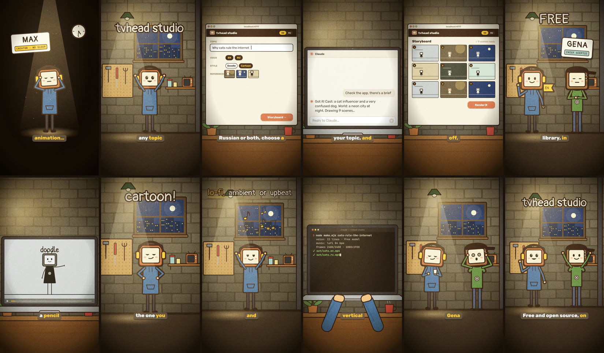
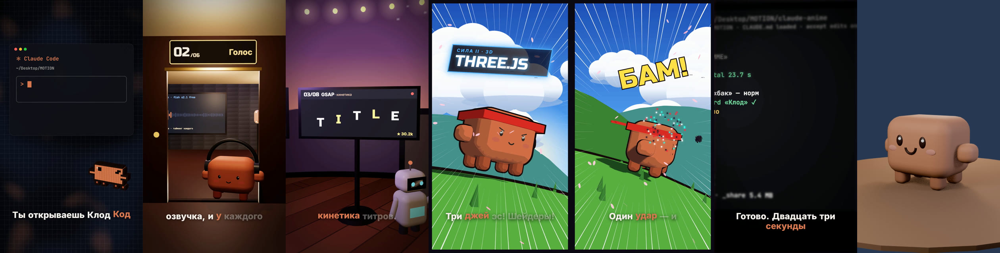
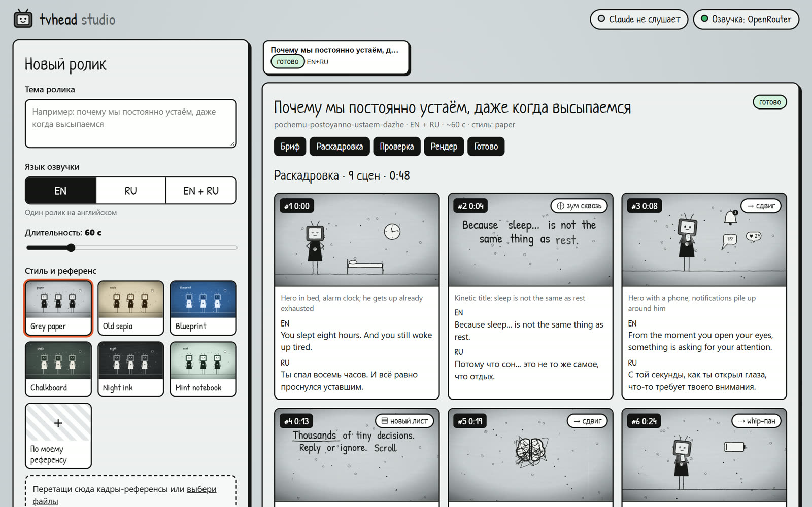
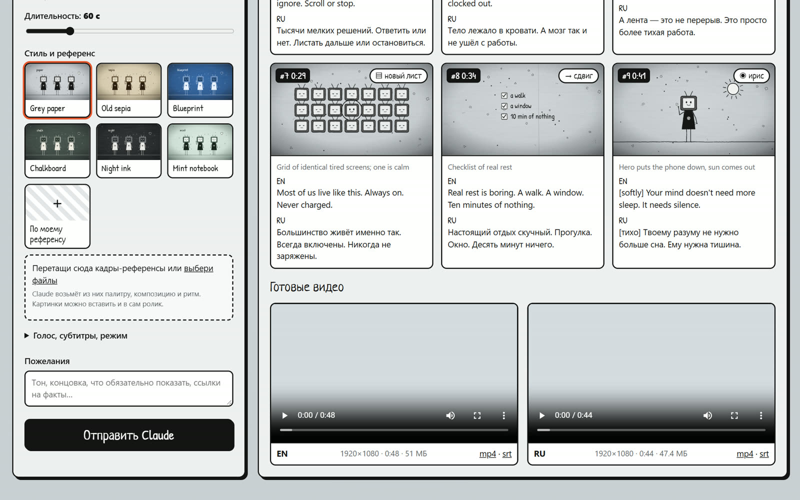

# tvhead studio: from a topic to a finished motion video

A [Claude Code](https://claude.com/claude-code) skill and a local app. Type a topic and get a **finished mp4**, horizontal **1920×1080** or vertical **1080×1920** (Shorts, Reels, TikTok), narrated in **English, Russian or both**, with free generated background music. Two looks:

- **Doodle**: hand-drawn and black-and-white. TV-headed stick figures on grey paper, floating pencil doodles, boiling lines and film grain.
- **Cartoon**: a warm night-garage cartoon. Thick outlines, colour, live laptop screens (a Claude chat, the app itself, a terminal), name badges, karaoke captions and a lo-fi beat.





The promo video above was made with the skill itself: `episodes/promo/story.json` → `node make.mjs promo`.

## Four skills in one plugin

| Skill | What it makes |
|---|---|
| `tvhead-video` | narrated doodle / cartoon / stickman explainers in 13+ looks, the local studio app (brief → storyboard → render) |
| `motion-studio` | social-media motion reels in Remotion, **five styles from one command**: kinetic motion with a voxel mascot, cozy-3D elevator tower, cozy-3D film set with a clapperboard, an **anime opening** (cel shading, ink outlines, impact frames, speed lines), and a **"shot on a phone"** laptop-screen look (handheld camera, depth of field) |
| `ai-montage` | documentary montage from real material: charts from real data, licensed archive photos, marker over footage, honest maths |
| `blender-3d` | 3D scenes and plates from Blender 5.2 (headless or via Blender MCP), a ready clay-mascot turntable in cozy or toon look, PNG + alpha for compositing |



`motion-studio` in short:

```bash
bash plugins/tvhead/skills/motion-studio/scripts/setup-kit.sh --python --plugins   # once: libraries, Whisper, Blender & GSAP skills
bash plugins/tvhead/skills/motion-studio/scripts/new-project.sh ~/Desktop/MOTION/my-reel anime   # reel | tower | set | anime | screen
npm run voice && npm run asr && npm run music      # free narration, a pronunciation check, generated music
npm run stills -- 60,200,400                       # one contact sheet before rendering
npm run render && npm run seams                    # render, then check every cut
npm run deliver -- ~/Desktop/MOTION my-reel        # master at −14 LUFS + a phone copy under 29 MB, both verified
```

Every frame is a pure function of time, captions stay inside the Reels/TikTok/Shorts safe zone (x 60–960, y 160–1420),
numbers on screen come from code or real data, and every style was checked from a clean project.

## Features

- **Two engineering formats for vertical shorts.** `underground`: a flat cutaway of a hidden workshop (under a garage, in a basement or a dacha attic) that gets upgraded line by line — HUD counter, upgrade chips, stamps, two-tone captions and a summary card. `marker`: a hand with felt-tip markers draws the object, strikes problems in red, draws fixes in green and blue with real arithmetic next to them, then flips to a summary page — with marker squeaks synced to every stroke.
- **Classic stickman styles + a director.** Five stick-figure looks adapted from [stickman-video-director](https://github.com/kaomei/stickman-video-director) (MIT): minimalist lines on white or black, red-beanie Zeke in a tech studio or cinematic places, prehistoric dark comedy, cozy everyday stories, and a historical cartoon with Edo, Egyptian and Roman sets and costumes. Every story also gets a **director's proposal** (5-stage "heartbeat" storyboard with checks) and an **AI-video prompt package**: standalone ~10-second prompts for Gemini Omni Flash, Veo or Kling with frozen style, cast and voice locks.
- **Eight looks, one story API.** Doodle, cartoon, **3D desk** (UI lying on a desk under a moving 3D camera, a clay cube mascot hopping over a post, a timeline or a beat maker), **neon noir** (painted scenes + clean infographic cards), **Dota-like** dark fantasy, **Roblox-like** brick game, **8-bit** and **comic**. Each brings its own places, characters, HUD props, caption style and music. Set `"look": "cartoon"` (or pick **Cartoon** in the app) for the warm garage cartoon. It comes with its own places (`garage`, `desk`, `blackout` with a spotlight), a `screen` prop that plays a live Claude chat, the studio app, a terminal or a doodle video, name `badge`s and outlined kinetic type.
- **Real 3D from After Effects.** With After Effects installed, a scene can have a 3D background built and rendered by AE: extruded titles, a 3D clay mascot, cards flying past the camera, ring tunnels — lights, shadows and camera moves included, with characters and captions still drawn on top. Claude can also drive AE directly through the After Effects MCP server.
- **Code-rendered 3D films.** `films/promo3d` is a full 60-second 3D promo built in three.js: a clay cube living in a dark video editor on a desk, real depth of field, motion blur and soft shadows from GPU accumulation, synthesized sound design and music on the same timeline as the picture, English narration (free Fish voice, or the local Kokoro model offline). Every frame is a pure function of time, so a revision re-renders only what changed; a contact-sheet mode checks every beat before the full render. See `films/promo3d/README.md`.
- **Directed, then checked.** The skill works in three rules (adapted from the ideas of the Breakout Motion skill): quality by default (a living camera, depth, acting type, motion blur and depth of field where it is spatial, music and SFX from the start), direction before building (variants for the heavy scenes, a plan card per shot, a probe of the riskiest moment), and the first build treated as a draft. Measurable acceptance is done by tools, not by eye: `tools/verify.mjs` (codec, yuv420p, constant fps, frame count, timestamps, AAC, loudness, true peak, silence), `tools/sheet.mjs` (contact sheets, every frame around a seam, cut candidates) and `tools/accents.mjs` (where the hits of the real mix are, in frames). `films/duet` is a 130-second 3D character film (clay agents building the studio together, choreography from `lib/choreo.js`), and `films/promo15` is a 15-second 60 fps kinetic promo built that way, with a new 150 BPM `hype` music preset.
- **After Effects animations.** Anything exported from After Effects as Lottie (Bodymovin / LottieFiles) plays inside the video, frame-accurate and vector-sharp, as a `lottie` prop; a starter pack (tick, burst, confetti, pin, heart, arrow, sparkle, loader) is included. See `references/after-effects.md`.
- **Free background music.** Lo-fi, ambient, upbeat, chiptune, synthwave or epic, composed on the fly from code (no samples, no API). It follows the edit: the drums come in after the intro, drop out in dark scenes and hit on the big transitions, and the music ducks under the voice. You can also bring your own mp3.
- **Free narration.** Fish Audio S2.1 (free tier) runs through OpenRouter. Use any voice from the fish.audio library or your own clone: the id is in the link, `fish.audio/m/<id>`.
- **16:9 or 9:16.** Set `"format": "9:16"` (or flip the toggle in the app) for vertical video. Layouts, kinetic type, camera moves and captions are re-laid for the tall frame; captions stay clear of the Shorts/Reels/TikTok UI. Any story can also be rendered the other way with `--format 9:16`.
- **EN, RU or both from one story.** The pictures are shared, and each language gets its own voice and timing. You get `out/<slug>.en.mp4` and `out/<slug>.ru.mp4`, each with an `.srt`.
- **Edited like a motion designer would.**
  - Velocity-matched transitions: cut-the-curve, zoom-through and inverse zoom, plus whip pan, iris, wipe and page.
  - Kinetic type: each word lands exactly when it is spoken.
  - Doodle infographics: counter, bars, pie, progress, timeline, checklist and an odd-one-out grid.
- **Your own cast and world.** In the app's **Cast & world** tab, save cards for characters, places, styles and ideas, with reference images. Tick them in a brief, or just describe who and where in two text fields. Claude turns them into characters built from about 70 parts (11 heads, 9 bodies, 14 hats, glasses, ties, backpacks, capes, held items) and 16 environments (office, city at night, subway, forest, sea, space, stage…) with rain, snow, leaves or wind. Anything missing, Claude invents from the topic's meaning or draws as new parts in code. The storyboard opens with a cast sheet you can approve or correct.
- **A living rig.** About 20 poses and 17 faces. The figures anticipate moves, their antennas swing after a move, and they squash on landing. There are about 50 props.
- **Themes and references.** Six palettes: grey paper, sepia, blueprint, chalkboard, night and mint. You can also upload your own frames, and Claude takes the palette and pacing from them. User photos can appear in the video as taped polaroids.
- **Custom motion.** For one-off scenes, write GSAP timelines (seeked and deterministic) inside the episode.
- **Fast.** Rendering runs at about real time: 50 s of 1080p takes about 30 s on 16 threads.

## The app

The interface speaks **English and Russian** — switch with the RU / EN toggle in the header (it follows your browser language on first start and is independent of the narration language).



1. Double-click the **tvhead studio** shortcut on your desktop (create it once with `npm run shortcut` in the studio, or `bootstrap.sh --shortcut`). It starts the app in the background (no console window) and opens http://localhost:4777; clicking it again just reopens the page. The ⏻ button in the header stops it. (`start-app.cmd` / `./start-app.sh` / `npm run app` do the same.)
2. Pick the languages (EN / RU / EN + RU), the format (16:9 / 9:16), the look (eight to pick from) and the music, choose a palette or drop in reference images, tick cards from your Cast & world library or describe the characters and places, and type the topic.
3. Tell Claude in chat: **"check the tvhead app"**. Claude starts listening to the app (the header shows "Claude is listening"), picks up the brief, and writes the script and a storyboard with transitions.
4. Review the frames. You can edit the narration right in the cards or send feedback. Then press **Render**.
5. Watch and download the finished videos in the app.

**Claude works on its own by default (2.15).** Pick a look, describe or tick characters, send the idea and wait: the app runs Claude Code in the background (`claude -p` with the skills), the storyboard appears in the job, you press **Render** and the video shows up in the job and in the **Videos** tab. "Claude in my chat" is still there if you want to steer by hand.

- **Two families of looks.** *tvhead* (the 15 character looks) and *motion-studio* 9:16 reels: motion reel, Clawd's tower, film set, anime opening, shot on a phone, documentary montage, 3D from Blender. A motion job builds a Remotion project in `~/Desktop/MOTION/<id>` (`TVHEAD_MEDIA` changes the folder), the storyboard is its contact sheet plus the voiced lines, and Render runs `npm run render` + `deliver` (−14 LUFS master and a phone copy).
- **Videos tab.** Every mp4 in the MOTION folder and in the studio's `out/`, grouped by folder, with thumbnails, a player, the phone copy and "make a similar one" (opens the brief with the matching look).
- **Built-in cast & world.** The library starts with our own cards (clay, voxel and anime Clawd, the helper robot, the bug; the tower, film set, anime hill, night desk, chart terminal, archive photos, notebook, cutaway, marker sheet; cozy 3D / anime / phone-shot / kinetic styles; listicle, meta-reel, "what if you invested", comment-word CTA ideas), and the "what Claude builds from" catalog lists the motion-studio mascots, accessories, worlds and effects.



## Install

```
/plugin marketplace add Vladic20/tvhead-studio
/plugin install tvhead@tvhead-studio
```

You need Node ≥ 18, ffmpeg and Google Chrome. On first use the skill sets up its studio in `~/tvhead-studio`. For `motion-studio` run its `scripts/setup-kit.sh` once (it fills `~/motion-kit`); for `blender-3d` install Blender 5.2 LTS.

Put your key into `~/tvhead-studio/.env`:

```
OPENROUTER_API_KEY=sk-or-v1-...
```

Get a key at https://openrouter.ai/keys.

- The default model is free, but OpenRouter limits free models to about 20 requests per minute plus a daily cap.
- For a more "acted" delivery, set the paid model `TVHEAD_TTS_MODEL=fish-audio/drama-3` (about $2 per million characters).
- A Fish Audio key only works with paid Fish API credit. The free fish.audio plan credits don't apply to the API.
- Captions and cues use free word timing aligned on the audio's pauses. For more precise sync, set `TVHEAD_STT=on` (Whisper, about $0.0002 per minute).

## Without the app

Just ask Claude: *"Make a 60-second video about why we procrastinate, in English and Russian."*

Commands inside the studio:

```bash
node make.mjs demo --stills auto     # one frame per scene → episodes/demo/build/<lang>/sheet.png
node make.mjs demo --preview         # fast 720p draft
node make.mjs demo                   # final 1080p for every language
node make.mjs demo --format 9:16     # the same story as a vertical 1080×1920 video
node make.mjs promo                  # the cartoon-style promo (9:16, EN + RU)
node make.mjs look-dota              # 15-second test of a look (look-desk3d, look-noir, look-blocks, look-pixel, look-comic, look-stick, look-beanie, look-prehistoric, look-cozy, look-history, look-underground, look-marker)
node make.mjs demo --director        # only the director's proposal + AI-video prompts (build/proposal.md, build/<lang>/prompts.md)
node voices.mjs deep calm --lang en  # search Fish voices (no key needed)
```

## What's inside

```
plugins/tvhead/skills/motion-studio/   SKILL.md, references/ (styles, anime, cozy3d, phone-shot, montage, fx libraries, audio, Blender),
                                       template/ (Remotion project: reel, cozy3d, anime, screen, montage lib, tools), external/ (MIT recipes)
plugins/tvhead/skills/ai-montage/      documentary montage on the motion-studio template
plugins/tvhead/skills/blender-3d/      scripts/plate.py — clay mascot plate (cozy / toon, turntable / hop / still)
plugins/tvhead/skills/tvhead-video/
  SKILL.md                 the workflow Claude follows (chat requests and app jobs)
  references/              story.json API, motion rules, writing guide, reference sheet
  scripts/bootstrap.sh     sets up or refreshes the studio (~/tvhead-studio)
  template/
    make.mjs               story.json → voice → timeline → frames → mix → mp4, once per language
    app/                   local studio app: server, Claude bridge, UI
    engine/                SVG drawing: paper, doodles, rig, props, kinetic type, transitions, cartoon style + live screens
    lib/                   story → timeline, TTS and alignment, music generator, sound mix, parallel frame capture
```

## Credits

- The motion rules are distilled from open skills: [HyperFrames](https://github.com/heygen-com/hyperframes), [GSAP skills](https://github.com/greensock/gsap-skills), [Charlie's motion-graphics-skills](https://github.com/charlie947/motion-graphics-skills), [video-shotcraft](https://github.com/Vincentwei1021/video-shotcraft), [product-launch-motion](https://github.com/AbubakrChan/product-launch-motion) and [claude-motion-design](https://github.com/howseen-ai/claude-motion-design). For more, see [awesome-claude-video-skills](https://github.com/zhuyansen/awesome-claude-video-skills).
- `motion-studio` builds on [Remotion](https://github.com/remotion-dev/remotion) and its [skills](https://github.com/remotion-dev/skills), [three.js](https://github.com/mrdoob/three.js), [GSAP](https://github.com/greensock/GSAP), [LYGIA](https://github.com/patriciogonzalezvivo/lygia), [Flubber](https://github.com/veltman/flubber), [Rough.js](https://github.com/rough-stuff/rough), [faster-whisper](https://github.com/SYSTRAN/faster-whisper) and [Chatterbox](https://github.com/resemble-ai/chatterbox); it vendors recipes from [charlie947/motion-graphics-skills](https://github.com/charlie947/motion-graphics-skills) and [howseen-ai/claude-motion-design](https://github.com/howseen-ai/claude-motion-design) (both MIT, licences kept in `external/`). `blender-3d` works with [Blender Agent Skills](https://github.com/EL4CTEO/blender-skills). The cozy-3D, anime and phone-shot looks were rebuilt from scratch after reference reels; no assets from them are used.
- The code-rendering approach started from [garazh-skill](https://github.com/lubluniky/garazh-skill) (MIT); the cartoon look (warm garage, outlines, badges, karaoke captions, the Claude chat on a laptop) is modelled on its cartoon reel.
- The two sample After Effects exports in `episodes/look-lottie/ae` come from the [lottie-web](https://github.com/airbnb/lottie-web) test suite (MIT); lottie-web plays them (MIT).
- Fonts: Patrick Hand, Neucha, Pangolin, Rubik, JetBrains Mono, Inter, Bangers, Russo One, Cinzel, Cormorant SC and Press Start 2P (SIL OFL 1.1).
- "Dota-like" and "Roblox-like" looks are original drawings inspired by those games' visual language; no game assets or logos are used. GSAP is used under its standard no-charge license.
- Voices are Fish Audio voice models, used under Fish Audio's terms. Don't use voices that imitate real people without their consent.

MIT, see [LICENSE](LICENSE).
